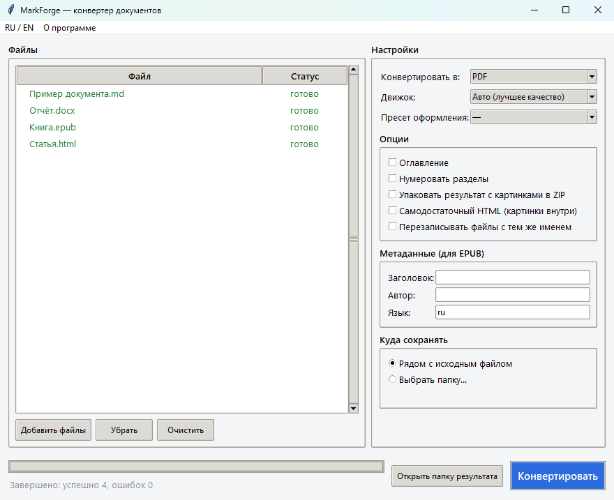

# MarkForge

Конвертер документов для Windows: **Markdown ↔ Word (.docx) ↔ EPUB ↔ HTML**, плюс экспорт в **PDF**.
Одно ядро и три входа к нему: окно с перетаскиванием файлов и пакетной конвертацией, командная строка и
небольшой HTTP-сервис. Если установлен pandoc — конвертирует через него, если нет — встроенным движком
на чистом Python. Появился из своей рутины: тексты пишутся в Markdown, сдаются в Word и PDF, а читаются
на телефоне в EPUB.



## Что умеет

- **Окно**: перетащили файлы или папки, выбрали формат и оформление, нажали «Конвертировать»; прогресс,
  пакетная обработка, RU/EN.
- **Два движка с автовыбором**: `pandoc` (максимальное качество, если установлен) и встроенный `native`
  на python-docx, mammoth, ebooklib, markdown-it и xhtml2pdf. Программа сама берёт лучший из доступных.
- **Картинки не теряются**: при конвертации в Markdown или HTML они извлекаются в папку `media/` рядом
  с результатом или упаковываются в `.zip`; при конвертации в docx/epub/pdf — вшиваются в файл.
- **PDF с кириллицей** без внешних программ: системные шрифты Windows подхватываются автоматически.
- **Пресеты оформления** и свои шаблоны: `reference.docx` для Word, CSS для HTML/EPUB/PDF.
- **Ничего не перезаписывается** по умолчанию: результат получает имя вида `имя (1).docx`, исходный файл
  не трогается никогда; флаг `--overwrite` включает перезапись на месте.
- **HTTP-сервис** (FastAPI): тот же движок по сети, основа для веб- или мобильного клиента (см. [MOBILE.md](MOBILE.md)).

| Из \ В        | Markdown | Word | EPUB | HTML | PDF |
|---------------|:--------:|:----:|:----:|:----:|:---:|
| **Markdown**  |    —     |  ✓   |  ✓   |  ✓   |  ✓  |
| **Word**      |    ✓     |  —   |  ✓   |  ✓   |  ✓  |
| **EPUB**      |    ✓     |  ✓   |  —   |  ✓   |  ✓  |
| **HTML**      |    ✓     |  ✓   |  ✓   |  —   |  ✓  |

PDF — только как результат. Полный список пар с доступными движками: `markforge formats`.

## Установка

Нужен **Python 3.10+**; pandoc желателен, но не обязателен ([установка](https://pandoc.org/installing.html)).

```bat
:: из исходников
install.bat            :: поставит зависимости
run_gui.bat            :: откроет окно

:: как пакет
python -m pip install -e .
markforge-gui

:: один .exe без Python у пользователя
python -m pip install pyinstaller
python build_exe.py                 :: dist\MarkForge.exe
python build_exe.py --bundle-pandoc :: вшить pandoc внутрь, портативно
```

## Использование

**Командная строка**

```bat
markforge convert book.md -t epub --title "Моя книга" --author "Имя" --toc
markforge convert doc.docx -t md --zip
markforge convert page.html -t pdf
markforge batch .\docs -t pdf -o .\out --recursive
markforge formats          :: пары форматов и движки
markforge doctor           :: найден ли pandoc, есть ли PDF-движок
```

Ключи: `--backend auto|pandoc|native`, `--flavor gfm|markdown`, `--toc`, `--number-sections`, `--zip`,
`--embed` (самодостаточный HTML), `--overwrite`, `--reference-doc styles.docx`, `--css style.css`, `--preset book`.

**HTTP-сервис**: `run_api.bat` → http://127.0.0.1:8000 (форма проверки и `/docs`). Эндпоинты `POST /convert`
(файл + `target_format`), `GET /formats`, `GET /health`.

**Из Python**

```python
from markforge import convert, Format, ConvertOptions

res = convert("book.md", Format.EPUB,
              options=ConvertOptions(toc=True, epub={"title": "Книга", "authors": ["Автор"]}))
print(res.output_path, res.backend_used, res.warnings)
```

## Качество конвертации

- **pandoc** — эталон для всех пар, если установлен.
- **native** — без pandoc. Хорошо: `md↔html`, `docx→md`, `epub→md`, `md→epub`, любое `→pdf`. Упрощённо:
  `md→docx`, `html→docx` — заголовки, абзацы, жирный и курсив, списки, таблицы, картинки. Для сложного
  форматирования Word лучше поставить pandoc.
- **PDF** собирается из HTML встроенным `xhtml2pdf`; если у pandoc есть свой PDF-движок (LaTeX,
  wkhtmltopdf), качество вырастет само.

## Как устроено

Ядро (`markforge/core`) ничего не знает про окно, CLI и HTTP: все три вызывают одну функцию `convert()`.
Внутри — реестр пар «формат → формат → движок»: новый формат или движок регистрируется в реестре, остальной
код не меняется. Тесты (`python -m pytest`) гоняют конвертации на настоящих файлах во временной папке;
случаи, где нужен pandoc, без него пропускаются. CI — GitHub Actions на Ubuntu и Windows.
Подробности и как добавить формат — [ARCHITECTURE.md](ARCHITECTURE.md).

```
markforge/
  core/            форматы, опции, движок, реестр, медиа, пресеты
    backends/      pandoc / native / pdf
  surfaces/        cli.py, gui.py, i18n.py
  service/         api.py (FastAPI)
  assets/presets/  reference-clean.docx, book.css, article.css
samples/           пример документа и картинка к нему
tests/             pytest
```

Сделан в связке с Claude Code: архитектура «ядро отдельно от интерфейсов», матрица форматов и правила
работы с картинками — мои; код, тесты и окно написаны агентом и проверены на своих документах.

## Диагностика

- «pandoc не найден» — программа продолжит на встроенном движке; для лучшего качества установите pandoc.
- Кириллица в PDF выглядит неверно — не найден системный TTF-шрифт; на Windows обычно берутся Arial или Segoe UI.

## Лицензия

MIT — см. [LICENSE](LICENSE). © 2026 Fyodor Poplavskiy (Фёдор Поплавский).

---

**In English.** MarkForge is a desktop document converter for Windows: Markdown ↔ Word (.docx) ↔ EPUB ↔ HTML,
plus export to PDF. One conversion core is shared by a Tkinter GUI (drag-and-drop, batch mode, RU/EN), a CLI
and a small FastAPI service. It uses pandoc when installed and falls back to a built-in pure-Python engine
otherwise; images are extracted to `media/` or packed into a ZIP; PDF export needs no external tools and
handles Cyrillic with system fonts. Tests: pytest; CI on Ubuntu and Windows.
